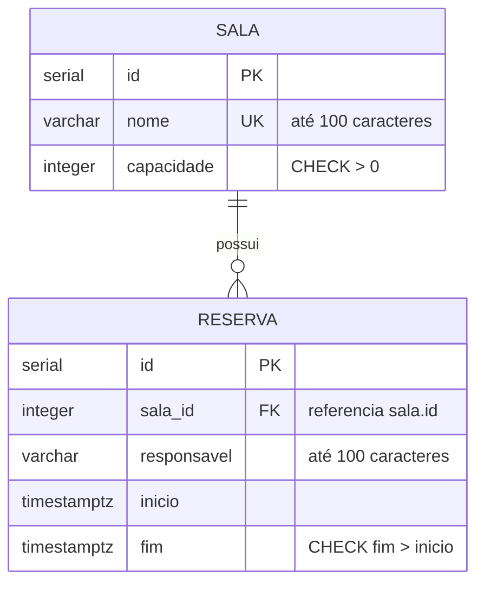

# Reserva de Salas — Monolito em Camadas

Trabalho semestral de **Arquitetura de Software** (Prof. Maikon Bueno — 2026/2).
**Organização escolhida: A · Monolito em camadas.**

API REST para cadastrar salas e reservar horários. A regra central do negócio é: **não pode haver
duas reservas com horários sobrepostos na mesma sala.**

---

## 1. Como rodar

Pré-requisito: Docker com Docker Compose.

```bash
docker compose up --build
```

Sobem dois containers separados: `db` (PostgreSQL 16) e `app` (a API, em http://localhost:3000).
O banco é criado automaticamente pelo `db/init.sql` na primeira execução.

Para zerar o banco (apaga os dados): `docker compose down -v`.

### Testando a API

```bash
# criar sala
curl -X POST localhost:3000/salas -H 'content-type: application/json' \
  -d '{"nome":"Laboratório 1","capacidade":30}'

# listar salas
curl localhost:3000/salas

# criar reserva
curl -X POST localhost:3000/reservas -H 'content-type: application/json' \
  -d '{"salaId":1,"responsavel":"Ana","inicio":"2026-12-01T10:00:00Z","fim":"2026-12-01T12:00:00Z"}'

# mesma sala, horário sobreposto  ->  409 (conflito)
curl -X POST localhost:3000/reservas -H 'content-type: application/json' \
  -d '{"salaId":1,"responsavel":"Bia","inicio":"2026-12-01T11:00:00Z","fim":"2026-12-01T13:00:00Z"}'

# listar reservas (todas, ou de uma sala)
curl localhost:3000/reservas
curl "localhost:3000/reservas?salaId=1"

# cancelar reserva  ->  204
curl -X DELETE localhost:3000/reservas/1
```

### Rotas (5)

| Método | Rota | Descrição | Respostas |
|---|---|---|---|
| POST | `/salas` | Cadastra sala (`nome`, `capacidade`) | 201, 400, 409 (nome repetido) |
| GET | `/salas` | Lista as salas | 200 |
| POST | `/reservas` | Cria reserva (`salaId`, `responsavel`, `inicio`, `fim`) | 201, 400, 404 (sala inexistente), 409 (conflito de horário) |
| GET | `/reservas` | Lista reservas; filtro opcional `?salaId=` | 200, 400 |
| DELETE | `/reservas/:id` | Cancela uma reserva | 204, 404 |

### Testes e verificação

```bash
npm install
npm test                    # testes da regra de negócio (sem banco)
npm run verificar-camadas   # confere se as camadas fechadas foram respeitadas
```

---

## 2. Arquitetura

**Estilo:** monolito em camadas (*Layered*, Aula 06) — arquitetura física monolítica (1 quantum:
uma aplicação, um deploy, um banco) e particionamento de topo **técnico**.

```
 HTTP ──►  APRESENTAÇÃO  ──►  NEGÓCIO  ──►(interface)◄──  PERSISTÊNCIA  ──►  PostgreSQL
           src/apresentacao   src/negocio                  src/persistencia     (container db)
           rotas/controllers  services + regras            repositórios + SQL
                              + interfaces dos repos
```

Cada camada só conversa com a imediatamente inferior (**camadas fechadas**). A seta entre negócio e
persistência é invertida pela interface (**DIP**): o negócio define o que precisa; a persistência obedece.

| Camada | Pasta | Responsabilidade | O que NÃO sabe |
|---|---|---|---|
| Apresentação | `src/apresentacao` | Receber HTTP, converter entrada, chamar o service, devolver status e JSON | Regras de negócio; que existe PostgreSQL |
| Negócio | `src/negocio` | Validações e regras (conflito de horário); define as interfaces dos repositórios | Que existe HTTP, Express ou PostgreSQL |
| Persistência | `src/persistencia` | Implementar as interfaces com SQL no PostgreSQL | Regras de negócio; que existe HTTP |

---

## 3. Requisitos do trabalho → onde estão implementados

### Requisitos técnicos

| Requisito | Implementação |
|---|---|
| Código em repositório git | Este repositório |
| Roda com Docker | `Dockerfile` (app) + `docker-compose.yml`; basta `docker compose up --build` |
| PostgreSQL em container próprio e separado | Serviço `db` (`postgres:16-alpine`) no `docker-compose.yml`, distinto do serviço `app`; dados em volume `pgdata` |

### Requisitos da organização A

| Requisito | Implementação |
|---|---|
| **Camadas fechadas** | Apresentação → Negócio → Persistência, sem pular. Os controllers só importam services; nenhum arquivo de `apresentacao/` importa `persistencia/`. Verificado automaticamente por `ferramentas/verificar-camadas.mjs` (falha se uma camada importar o que não deve). |
| **Repositório atrás de interface (DIP)** | `negocio/sala-repository.ts` e `negocio/reserva-repository.ts` são interfaces **na camada de negócio** (do lado de quem usa). `persistencia/*-repository-pg.ts` as implementam. O negócio não importa `pg`. |
| **Injeção de dependência** | Services recebem repositórios pelo construtor; controllers recebem services pelo construtor. Todos os `new` ficam em `src/main.ts` (*composition root*) — DI manual, sem container. Prova do benefício: `reserva-service.test.ts` injeta repositórios falsos em memória e testa a regra sem banco. |
| 1 aplicação | Um único processo Node, um deploy |
| 2 entidades | `Sala` e `Reserva` |
| 4 a 6 rotas | 5 rotas (tabela acima) |

---

## 4. Banco de dados (PostgreSQL)

Script: [`db/init.sql`](db/init.sql), executado automaticamente pelo container do banco.



**Tabela `sala`**

| Coluna | Tipo | Restrições |
|---|---|---|
| id | SERIAL | chave primária |
| nome | VARCHAR(100) | NOT NULL, UNIQUE |
| capacidade | INTEGER | NOT NULL, CHECK (capacidade > 0) |

**Tabela `reserva`**

| Coluna | Tipo | Restrições |
|---|---|---|
| id | SERIAL | chave primária |
| sala_id | INTEGER | NOT NULL, chave estrangeira → `sala(id)` |
| responsavel | VARCHAR(100) | NOT NULL |
| inicio | TIMESTAMPTZ | NOT NULL |
| fim | TIMESTAMPTZ | NOT NULL, CHECK (fim > inicio) |

Índice: `idx_reserva_sala_inicio` em `reserva(sala_id, inicio)` (acelera a busca de conflitos).

**Conflito de horário:** dois intervalos se sobrepõem quando `inicioExistente < fimNovo` **e**
`fimExistente > inicioNovo`. Reservas "coladas" (fim de uma = início da outra) são permitidas.
O repositório apenas **consulta** as reservas sobrepostas; quem **decide** que é um conflito é o
`ReservaService` (a regra fica no negócio, não no SQL).

---

## 5. Estrutura de arquivos

```
reserva-salas/
├── docker-compose.yml            # serviços: db (PostgreSQL) e app (API)
├── Dockerfile                    # imagem da aplicação
├── .dockerignore / .gitignore
├── .env.example                  # variáveis para rodar fora do Docker
├── package.json / tsconfig.json  # dependências (express, pg) e compilação TypeScript
├── db/
│   └── init.sql                  # criação das tabelas
├── ferramentas/
│   └── verificar-camadas.mjs     # governança: confere as camadas fechadas
└── src/
    ├── main.ts                   # COMPOSITION ROOT: todos os `new` e a injeção
    ├── apresentacao/
    │   ├── app.ts                # monta o Express e as 5 rotas
    │   ├── salas-controller.ts   # POST/GET /salas
    │   ├── reservas-controller.ts# POST/GET /reservas, DELETE /reservas/:id
    │   └── http.ts               # erro de negócio → status HTTP; helpers
    ├── negocio/
    │   ├── sala.ts, reserva.ts               # entidades (tipos)
    │   ├── sala-repository.ts                # INTERFACE (DIP)
    │   ├── reserva-repository.ts             # INTERFACE (DIP)
    │   ├── sala-service.ts                   # regras de sala
    │   ├── reserva-service.ts                # regras de reserva (conflito de horário)
    │   ├── erros.ts                          # ErroDeValidacao / NaoEncontrado / Conflito
    │   └── reserva-service.test.ts           # testes com repositórios falsos
    └── persistencia/
        ├── conexao.ts                        # pool de conexões PostgreSQL
        ├── sala-repository-pg.ts             # implementa SalaRepository
        └── reserva-repository-pg.ts          # implementa ReservaRepository
```

### Fluxo de uma requisição (`POST /reservas`)

1. `app.ts` roteia para `ReservasController.criar`.
2. O controller converte o corpo JSON (ids e datas) e chama `ReservaService.criar`.
3. O service valida, confere se a sala existe (`SalaRepository`), busca reservas sobrepostas
   (`ReservaRepository.listarNoPeriodo`) e decide: conflito → `ErroDeConflito`; ok → `criar`.
4. O repositório concreto (`ReservaRepositoryPg`) executa o `INSERT` no PostgreSQL.
5. O controller responde `201` com o JSON; se houve erro de negócio, `http.ts` o traduz em 400/404/409.

---

## 6. Como adicionar uma nova funcionalidade (exemplo)

**"Listar reservas de um responsável" (`GET /reservas?responsavel=Ana`):**

1. **Negócio:** acrescentar `listarPorResponsavel(nome)` em `reserva-repository.ts` (interface) e a
   chamada/regra em `reserva-service.ts`.
2. **Persistência:** implementar o método em `reserva-repository-pg.ts` (`SELECT ... WHERE responsavel = $1`).
3. **Apresentação:** ler `req.query.responsavel` em `reservas-controller.ts` e repassar ao service.
4. **Composição:** nada muda em `main.ts`. Rodar `npm test` e `npm run verificar-camadas`.

Outro exemplo: **editar reserva** (`PUT /reservas/:id`) — método `atualizar` no repositório, o service
reaplica a regra de conflito ignorando a própria reserva, e uma nova rota no `app.ts`.

---

## 7. Decisões e limitações

- **`pg` (SQL direto) em vez de ORM:** menos camadas "mágicas", SQL visível e fácil de explicar.
- **DI manual em vez de container de IoC:** suficiente para o tamanho do sistema; o container só
  automatizaria os `new` do `main.ts` (Aula 05: "o container é a última peça").
- **Sumidouro de arquitetura:** `GET /salas` atravessa as camadas sem regra (Aula 06). É a minoria das
  requisições (regra 80-20), por isso o estilo continua adequado.
- **Concorrência:** a checagem de conflito (consultar e depois inserir) não é atômica; duas requisições
  simultâneas para o mesmo horário poderiam passar juntas. Solução futura: *exclusion constraint*
  do PostgreSQL ou transação com bloqueio. Fora do escopo deste trabalho.
- Sem autenticação, paginação ou migrações versionadas (o `init.sql` só roda com o volume vazio).

---

## 8. Entrega no git

```bash
git init
git add .
git commit -m "Reserva de salas: monolito em camadas"
git branch -M main
git remote add origin <URL-DO-REPOSITORIO>
git push -u origin main
```

Só o que estiver commitado até **29/11** será considerado.
